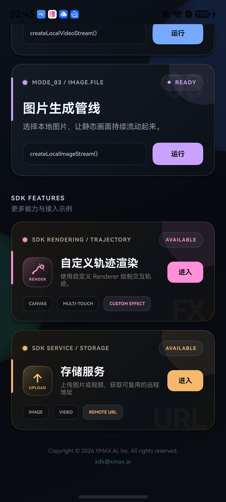
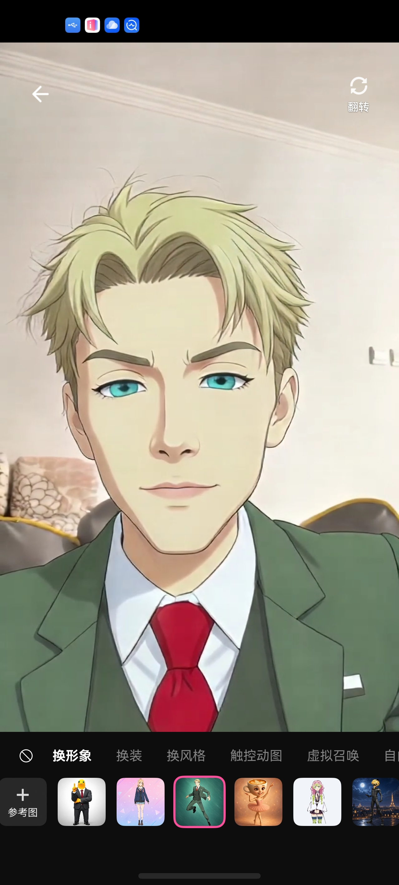

<p align="center">
  
</p>

<p align="center">
  <a href="https://flutter.dev/"></a>
  <a href="https://dart.dev/"></a>
  <a href="https://developer.apple.com/ios/"></a>
  <a href="https://developer.android.com/"></a>
  <a href="https://platform.xmaxai.com/"></a>
  <a href="./LICENSE"></a>
</p>

We introduce XmaxSDK, a Flutter SDK designed for real-time interactive video generation via Xmax models. XmaxSDK implements an end-to-end pipeline covering media acquisition, video streaming, frame-by-frame generation, and on-device rendering, enabling developers to seamlessly integrate low-latency, high-fidelity video transformations into creative applications at a much lower cost than alternative solutions.

<p align="center"></p>

<br>

## What you can build with XmaxSDK

<table>
  <tr>
    <th width="24%" align="left">Realtime Use Case</th>
    <th width="60%" align="left">Description</th>
    <th width="16%" align="center">Demo</th>
  </tr>
  <tr>
    <td rowspan="2" width="24%" valign="middle">
      <strong>Character Swapping</strong>
    </td>
    <td width="60%" valign="middle">
      Replace anyone in your live feed with a designated avatar in real time.
    </td>
    <td rowspan="2" width="16%" align="center" valign="middle">
      <a href="https://cdn.jsdelivr.net/gh/Xmax-AI/XmaxSDK-Flutter@main/materials/videos/use-cases/character-swapping.mp4">
        
        <br>
        <sub>▶ Play demo</sub>
      </a>
    </td>
  </tr>
  <tr>
    <td width="60%" valign="middle">
      <strong>Prompt:</strong> <code>视频中角色替换成参考图中角色</code>
      <br><br>
      <strong>Reference image:</strong> Select a clear image of the desired character with a clean background.
    </td>
  </tr>
  <tr>
    <td rowspan="2" width="24%" valign="middle">
      <strong>Virtual Try-On</strong>
    </td>
    <td width="60%" valign="middle">
      Seamlessly change outfits, preserving exact body shape, natural motion, and
      an authentic fit.
    </td>
    <td rowspan="2" width="16%" align="center" valign="middle">
      <a href="https://cdn.jsdelivr.net/gh/Xmax-AI/XmaxSDK-Flutter@main/materials/videos/use-cases/virtual-try-on.mp4">
        
        <br>
        <sub>▶ Play demo</sub>
      </a>
    </td>
  </tr>
  <tr>
    <td width="60%" valign="middle">
      <strong>Prompt:</strong> <code>视频中人物衣服替换成参考图中衣服</code>
      <br><br>
      <strong>Reference image:</strong> Select a clear image of the target outfit with a clean background.
    </td>
  </tr>
  <tr>
    <td rowspan="2" width="24%" valign="middle">
      <strong>Video Restyling</strong>
    </td>
    <td width="60%" valign="middle">
      Reimagine your world in any style with an immersive visual experience.
    </td>
    <td rowspan="2" width="16%" align="center" valign="middle">
      <a href="https://cdn.jsdelivr.net/gh/Xmax-AI/XmaxSDK-Flutter@main/materials/videos/use-cases/video-restyling.mp4">
        
        <br>
        <sub>▶ Play demo</sub>
      </a>
    </td>
  </tr>
  <tr>
    <td width="60%" valign="middle">
      <strong>Prompt:</strong> <code>视频风格变为参考图指定的风格</code>
      <br><br>
      <strong>Reference image:</strong> Select an image that captures the artistic style you want to apply.
    </td>
  </tr>
  <tr>
    <td rowspan="2" width="24%" valign="middle">
      <strong>AI Companions</strong>
    </td>
    <td width="60%" valign="middle">
      Summon virtual characters into your live camera feed and interact with them
      through gestures.
    </td>
    <td rowspan="2" width="16%" align="center" valign="middle">
      <a href="https://cdn.jsdelivr.net/gh/Xmax-AI/XmaxSDK-Flutter@main/materials/videos/use-cases/ai-companions.mp4">
        
        <br>
        <sub>▶ Play demo</sub>
      </a>
    </td>
  </tr>
  <tr>
    <td width="60%" valign="middle">
      <strong>Prompt:</strong> <code>指定角色在场景中互动</code>
      <br><br>
      <strong>Reference image:</strong> Select a clear image of the virtual character you want to summon with a clean background.
    </td>
  </tr>
</table>

<br>

## Why XmaxSDK?

<table>
  <thead>
    <tr>
      <th height="104" align="center" valign="middle">
        <br>Low latency
      </th>
      <th height="104" align="center" valign="middle">
        <br>Cost efficiency
      </th>
      <th height="104" align="center" valign="middle">
        <br>High fidelity
      </th>
    </tr>
  </thead>
  <tbody>
    <tr>
      <td>End-to-end latency is measured in , ensuring that updates to generation conditions and interaction controls are reflected instantly.</td>
      <td>Run on a , reducing inference costs by orders of magnitude versus datacenter GPUs like H100.</td>
      <td>Our models support real-time generation at up to , delivering production-ready, high-quality video output.</td>
    </tr>
  </tbody>
</table>

<br>

## Prerequisites

- Flutter 3.35 or later
- Dart 3.9 or later
- iOS 15.0 or later, or Android API 26 or later
- Java 17 for Android builds
- An Xmax API key

> [!WARNING]
> Never commit your Xmax API key to version control. Pass it securely at
> runtime or use short-lived temporary keys issued by the Xmax API. For step-by-step
> instructions, see [Authentication](https://platform.xmaxai.com/docs/authentication).

<br>

## Installation

XmaxSDK is published on [pub.dev](https://pub.dev/packages/xmax_sdk) and can also
be integrated from a Git revision or a local source checkout.

### pub.dev

Add XmaxSDK to your application's `pubspec.yaml`:

```yaml
dependencies:
  xmax_sdk: ^1.0.4
```

### Git

To use a release tag or commit directly from GitHub:

```yaml
dependencies:
  xmax_sdk:
    git:
      url: https://github.com/Xmax-AI/XmaxSDK-Flutter.git
      ref: 1.0.4
```

### Local path

To use a local source checkout during development:

```yaml
dependencies:
  xmax_sdk:
    path: ../XmaxSDK
```

Install the dependencies:

```bash
flutter pub get
```

<br>

## Host Configuration

### iOS

Set the deployment target to iOS 15.0 or later. For CocoaPods integration, use
the standard CocoaPods CDN source in `ios/Podfile`:

```ruby
source 'https://cdn.cocoapods.org/'

platform :ios, '15.0'

target 'Runner' do
  use_frameworks!

  # Keep the Flutter pod installation generated by the Flutter template here.
end
```

Enable camera and optional microphone permission handlers in the existing `post_install` block:

```ruby
post_install do |installer|
  installer.pods_project.targets.each do |target|
    flutter_additional_ios_build_settings(target)
    target.build_configurations.each do |config|
      config.build_settings['GCC_PREPROCESSOR_DEFINITIONS'] ||= [
        '$(inherited)',
        'PERMISSION_CAMERA=1',
        'PERMISSION_MICROPHONE=1',
      ]
    end
  end
end
```

Add a camera usage description to `ios/Runner/Info.plist`. Include the microphone
description if your app enables microphone input:

```xml
<key>NSCameraUsageDescription</key>
<string>This app uses the camera for real-time video input.</string>
<key>NSMicrophoneUsageDescription</key>
<string>This app uses the microphone for real-time audio input.</string>
```

Customize this message to match your application's user experience. XmaxSDK
automatically requests camera access when creating the video stream. With
`useMicrophone: true`, it also requests microphone access. Stream creation fails
with an `XmaxError` if a required permission is denied or unavailable.

See the complete [`example/ios/Podfile`](example/ios/Podfile) for a working setup.

With Swift Package Manager, the permission plugin derives its enabled permissions
from the usage descriptions in `Info.plist`. After adding a permission, refresh
the Swift package manifest and the app's derived build caches once, then rebuild;
an existing cached configuration can otherwise keep that permission disabled.

### Android

Set the application's minimum SDK to 26 and compile with Java 17 in
`android/app/build.gradle.kts`:

```kotlin
android {
    compileOptions {
        sourceCompatibility = JavaVersion.VERSION_17
        targetCompatibility = JavaVersion.VERSION_17
    }

    defaultConfig {
        minSdk = 26
    }
}
```

Use the standard Google and Maven Central dependency repositories in
`android/build.gradle.kts`:

```kotlin
allprojects {
    repositories {
        google()
        mavenCentral()
    }
}
```

Also make it available while Flutter plugins are resolved in
`android/settings.gradle.kts`:

```kotlin
pluginManagement {
    repositories {
        google()
        mavenCentral()
        gradlePluginPortal()
    }
}
```

Enable AndroidX and Jetifier in `android/gradle.properties`:

```properties
android.useAndroidX=true
android.enableJetifier=true
```

Declare the required permissions in `android/app/src/main/AndroidManifest.xml`:

```xml
<uses-permission android:name="android.permission.INTERNET" />
<uses-permission android:name="android.permission.CAMERA" />
<uses-permission android:name="android.permission.RECORD_AUDIO" />
<uses-permission android:name="android.permission.MODIFY_AUDIO_SETTINGS" />
```

`RECORD_AUDIO` is required only when using `useMicrophone: true`. External sources
can submit their own PCM audio without microphone permission. The example's
[`AndroidManifest.xml`](example/android/app/src/main/AndroidManifest.xml)
removes unused capabilities during manifest merging.

Release builds with R8 must also suppress warnings for optional device and serializer
APIs referenced by Tencent COS. Add the following rules to the
host application's Release ProGuard configuration:

```proguard
-dontwarn java.awt.**
-dontwarn javax.money.**
-dontwarn com.google.common.collect.ArrayListMultimap
-dontwarn com.google.common.collect.Multimap
-dontwarn org.javamoney.moneta.**
-dontwarn org.joda.time.**
-dontwarn springfox.documentation.spring.web.json.Json
```

The same configuration is available in the example's
[`proguard-rules.pro`](example/android/app/proguard-rules.pro).

<br>

## Quick Start

`XmaxConfiguration` uses `XmaxEnvironment.china` by default. For the overseas
service, set `environment: XmaxEnvironment.global` when creating `XmaxClient`.
This controls realtime-session and storage-service routing as well as log
language. Select `RealtimeModel.x2_1_1_preview_cn` for the China preview or
`RealtimeModel.x2_1_1_preview_us` for the global preview. Model selection and
service environment are separate settings; choose the appropriate pair for your deployment.
XLab selects the regional preview model for its language-selected environment.

### Generate and display video

The following Flutter widget creates a camera stream, starts real-time generation,
and binds the local and generated video tracks. Keep the manager and streams in
widget state for the lifetime of the screen.

```dart
import 'dart:async';

import 'package:flutter/material.dart';
import 'package:xmax_sdk/xmax_sdk.dart';

class RealtimePage extends StatefulWidget {
  const RealtimePage({super.key});

  @override
  State<RealtimePage> createState() => _RealtimePageState();
}

class _RealtimePageState extends State<RealtimePage> {
  static const _model = RealtimeModel.x2_1_1_preview_cn;
  late final XmaxRealtimeManaging _realtime;
  RealtimeMediaStream? _localStream;
  RealtimeMediaStream? _remoteStream;

  @override
  void initState() {
    super.initState();

    final client = XmaxClient(
      configuration: XmaxConfiguration(apiKey: 'YOUR_XMAX_API_KEY'),
    );
    _realtime = client.createRealtimeManager(
      options: const RealtimeConfiguration(model: _model),
    );
    unawaited(_start());
  }

  Future<void> _start() async {
    final localStream = await _realtime.createLocalCameraStream();
    if (!mounted) return;
    setState(() => _localStream = localStream);

    final remoteStream = await _realtime.startGeneration(
      localStream: localStream,
      context: RealtimeContext(
        prompt: '视频中角色替换成参考图中角色',
        referencePath:
            'https://platform.xmaxai.com/images/source/charx/chatx_image1.jpg',
      ),
    );
    if (!mounted) return;
    setState(() => _remoteStream = remoteStream);
  }

  @override
  void dispose() {
    unawaited(_realtime.close());
    super.dispose();
  }

  @override
  Widget build(BuildContext context) {
    final localStream = _localStream;
    if (localStream == null) {
      return const Center(child: CircularProgressIndicator());
    }

    return XmaxRealtimeDualVideo(
      localTrack: localStream.videoTrack,
      remoteTrack: _remoteStream?.videoTrack,
      videoContentMode: VideoContentMode.fill,
    );
  }
}
```

Both preview models default to 1024×1920 at 30 fps and support 1024×1920
and 1920×1024 camera formats. Create a stream without arguments to use the
model's default format and front camera, or provide a supported capture format:

```dart
final localStream = await _realtime.createLocalCameraStream(
  videoFormat: const RealtimeVideoFormat(width: 1920, height: 1024, fps: 30),
  position: CameraPosition.back,
);
```

Camera dimensions must exactly match an entry in `supportedVideoFormats`.
The existing `RealtimeCameraPreset` values are model-dependent and are not
supported by these preview models; use the default or an explicit format.
Providing both `videoFormat` and `preset` is invalid.

To include microphone audio, opt in when creating the camera stream:

```dart
final localStream = await realtime.createLocalCameraStream(useMicrophone: true);
```

The default is `false`. Microphone permission is requested during stream creation,
but capture starts only when connecting to realtime. The SDK uses Agora's built-in
microphone capture and publishes the audio with the camera stream, without local
microphone playback. Disconnecting stops microphone capture while retaining camera
preview; reconnecting the same stream starts capture again. Closing the manager or
stopping the camera stream also releases microphone capture.

`setLocalAudioVolume` does not control microphone input. `setRemoteAudioVolume`
controls generated audio playback independently and remains muted after stream
creation until your app enables it.

`XmaxRealtimeDualVideo` is the recommended video container. It keeps local
preview mounted beneath the remote result, reveals the result after its first
rendered frame, and restores preview when generation stops. Its
`remoteVideoFadeInDuration` is measured in seconds and defaults to `0.3`. Set it
to `0` to disable the transition; negative or nonfinite values also disable it.
Changes apply to the next fade-in, without changing an animation in progress.

For picture-in-picture or other custom layouts, compose separate
`XmaxRealtimeVideo(track: ...)` widgets for the local and remote tracks.

While the preview is ready and disconnected,
update the capture format without recreating the stream or view:

```dart
await _realtime.updateCameraFormat(
  videoFormat: const RealtimeVideoFormat(width: 1024, height: 1920, fps: 30),
);
final format = await _realtime.currentCameraVideoFormat;
```

Use either `preset` (preserves the current frame rate and encoding settings) or
`videoFormat` (provides a complete format), but not both.

The widget keeps the local camera preview underneath the generated video, enables
touch interaction by default, and returns to the local preview after
`disconnect()`.

To display a loading overlay, keep it visible after `startGeneration()` returns
and bind the returned remote track. Dismiss the overlay in the optional
`onRemoteVideoReady` callback, which fires when the first remote frame has been
rendered and the view starts showing it. Condition updates do not repeat this
notification; a new remote binding cycle does.

The SDK adapts uplink encoding and the returned video size independently as
network quality changes. Capture settings and the model's generation canvas stay
fixed. Recent successful quality levels are remembered per model for one hour.
During generation, call `setUplinkQualityLevel(RealtimeQualityLevel.l1)` or
`setDownlinkQualityLevel(RealtimeQualityLevel.l3)` to adjust a direction manually.
Manual changes do not change the automatic adaptation setting. To disable
automatic adaptation, pass `isAdaptiveQualityEnabled: false` to
`RealtimeConfiguration`. Each connection then starts at L1 without reading or
saving quality history, while manual changes remain available. Read the applied levels through
`uplinkQualityLevel` and `downlinkQualityLevel`; both are `null` before connection
completes or once disconnection starts. Downlink changes report the submitted
target, which may precede the corresponding video frames.

Uplink dimensions remain aligned to 4 pixels and retain at least 200000 pixels
for both preview models, even at lower quality levels. This input minimum does
not constrain returned video dimensions. The SDK resolves the generation canvas
separately and automatically requests contain padding when its aspect ratio
differs from the local media. Condition updates leave the current return size unchanged.

The default encoder preference is `maintainFramerate`. Unless explicitly set,
the uplink minimum bitrate is 500 kbps, capped at the resolved maximum bitrate.

Subscribe to `setUplinkVideoStatisticsListener` and
`setDownlinkVideoStatisticsListener` to display resolution, frame rate, bitrate,
packet loss, and media delay. Statistics become `null` when their stream ends.
These listeners work independently of logging and network-quality listeners.

An unfinished `startGeneration()` request is replaced by a newer call, including
while waiting for the first remote frame. The replaced future completes with
`XmaxErrorCode.cancelled` after cleanup. During established generation, condition
updates use the existing task without repeating first-frame loading. Other
foreground operations, such as switching cameras or manually changing quality,
are mutually exclusive and reject conflicting calls.

State listeners receive the current snapshot on registration and subsequently
only changed snapshots. Successful completion releases operation admission before
notifying your app, so a listener can start the next operation immediately.

For virtual try-on, pass `faceRestoration: true` to `startGeneration` to retain
the original face. The default is `false`; every condition update sends the value
provided for that call. Switching cameras automatically restores the cached
generation condition and face-restoration setting.

Camera generation audio is muted by default. To hear it, call
`await _realtime.setRemoteAudioVolume(0.8)` after creating the local stream;
the setting is applied when the generated stream is selected. Read it with
`await _realtime.remoteAudioVolume` (rounded to hundredths). Stopping generation
or disconnecting preserves the setting; creating a new camera or external stream resets it
to zero. Before the first stream is created, remote volume defaults to `1.0`.

Neither camera input nor external PCM input has local audio playback.
`await _realtime.localAudioVolume` returns `0.45`, and valid calls to
`setLocalAudioVolume()` succeed without changing it. Both volume setters reject
non-finite values and values outside `0...1`.

To update an active generation task, submit a new context without another local
stream:

```dart
await realtime.startGeneration(
  context: RealtimeContext(
    prompt: '视频中人物衣服替换成参考图中衣服',
    referencePath: anotherReferenceImageURL,
  ),
);
```

Switch between the front and rear cameras without rebuilding the manager:

```dart
final switchedStream = await realtime.switchCamera();
```

<br>

### External capture

Extend `RealtimeExternalVideoSource` to provide video captured, decoded, or processed
by your app. Keep `videoFormat` unchanged until delivery stops. In `start(sink:)`,
install your frame callback and return once the source is ready to deliver frames;
do not wait for generation or the first frame. In `stop()`, stop delivery and release
the sink reference. Your app retains ownership of its capture devices and players.

```dart
final localStream = await realtime.createExternalVideoStream(source: source);

// Bind localStream.videoTrack to XmaxRealtimeDualVideo.localTrack as usual.
final remoteStream = await realtime.startGeneration(
  localStream: localStream,
  context: RealtimeContext(prompt: 'Transform the supplied video'),
);

await realtime.disconnect(); // External delivery and local preview continue.
await realtime.stopExternalVideoStream(); // Detach after disconnecting.
```

Submit `RealtimeExternalVideoFrame` buffers through
`sink.pushVideo(frame, timestamp: timestamp)`. Accepted layouts are upright BGRA
and video-range NV12, with orientation and mirroring already applied. Timestamps
are nonnegative, strictly increasing `Duration` values from one monotonic clock;
keep them increasing across seeks and playback loops. The sink copies buffers
before returning and drops concurrent video input rather than building a queue.
Await submission futures to apply backpressure.

External input dimensions are not restricted to camera presets. The SDK resolves
an encoding format within the model's pixel-area limits, aligned to four pixels;
`sink.videoFormat` exposes it. Continue submitting the source dimensions: native
transport scales frames for encoding. Binding becomes `ready` without waiting for
a frame or a mounted view. No camera or microphone permission is requested.
Remote audio starts muted after binding; call `setRemoteAudioVolume` to enable it.

To supply audio, override `hasAudio` with `true` before binding and call
`sink.pushAudio(frame, timestamp: timestamp)` with interleaved, little-endian PCM16
or Float32 in a `RealtimeExternalAudioFrame`. Audio and video share the same
monotonic timeline. The SDK converts audio to 48 kHz mono PCM16 in 10 ms packets,
without local playback or an upload backlog while disconnected. Input audio
format must remain fixed; overlapping buffers are ignored and gaps start a new
segment without inserting silence. Await each audio submission before the next.

Report unrecoverable capture or decoding failures using `sink.reportError(error)`;
the SDK closes the realtime connection and detaches the local source. Detached
sinks ignore late frames. `close()` also detaches the source, but does not dispose
your app's devices or players.

XLab's **External Capture** entry selects a video from Photos and implements
`RealtimeFileVideoSource` in the example app. AVFoundation and MediaCodec decode
video and optional PCM, loop playback on a monotonic timeline, and submit through
the same public source/sink interfaces available to integrating apps. File decoding
is not part of the SDK's external-source API. The example uses
`client.createMediaService(model: model)` to select decoder dimensions before
binding, keeping raw frame transfers within the model's media limits.

<br>

### Listen for events

After creating `realtime`, register the listeners you need before creating the
input stream or starting generation.

| Listener | Purpose |
| --- | --- |
| `setStateListener` | Observe `idle → preparing → ready → connecting → connected → generating` and any failure reason. `ready` follows the first camera frame and mounted preview. |
| `setNetworkQualityListener` | Monitor uplink and downlink network quality. |
| `setPerformanceAlarmListener` | Detect device performance limitations or recovery, with a suggested video format when available. |

For example, monitor state changes and errors:

```dart
await realtime.setStateListener((state) {
  debugPrint('State: ${state.connectionState.value}');
  final error = state.reason?.error;
  if (error != null) {
    debugPrint('Error: ${error.code.value} ${error.message}');
  }
});
```

Handle errors from explicit method calls with `try` / `catch` around the awaited
call. Runtime failures are reported through `state.reason?.error`.

<br>

### Resource Cleanup

- **`disconnect()` — Stop Remote Generation**

  Ends the remote session and cancels billing while keeping the local camera stream
  and preview active. A new session can later use the same local stream:

  ```dart
  await realtime.disconnect();
  ```

- **`close()` — Full Teardown & Release**

  Ends the remote session, stops local media capture, and releases all RTC resources.
  Use this when leaving the generation screen:

  ```dart
  await realtime.close();
  ```

  If another manager owns the shared RTC engine, closing a waiting manager cancels
  its queued acquisition without stopping the active owner's preview. Native
  initialization already in progress finishes and releases its resources before
  teardown completes.

> **Note:** `disconnect()` and `close()` are alternatives, not sequential steps.
> When exiting a screen, call `close()` directly—there is no need to call
> `disconnect()` first.

<br>

### Remote audio and video frames

Register one listener to receive the result user's decoded video and PCM audio:

```dart
await realtime.setRemoteMediaFrameListener((frame) async {
  // Your recorder or processor should return a Future for asynchronous work.
  await recorder.append(frame);
});

// Stop observation and discard queued delivery without changing playback.
await realtime.setRemoteMediaFrameListener(null);
```

Each `RealtimeMediaFrame` carries a `streamID`, an `isDiscontinuous` flag, and
`content`: either a `RealtimeVideoFrame` or a `RealtimeAudioFrame`. Video is
owned, tightly packed planar I420 (Y, then U, then V), with dimensions and
clockwise display rotation. Audio is owned, interleaved little-endian PCM16,
with sample rate, channel count, and samples per channel. Treat the bytes as
read-only.

Both tracks use `presentationTimeStamp` on the same receiver rendering timeline,
not the source file's timecode. Audio time advances by sample count, even when
native callbacks arrive in batches. Schedule or mux both tracks using one origin;
callbacks are delivered in arrival order, not sorted across tracks by timestamp.
A changed stream identity, discontinuity, format change, or clock jump may require
a new recording segment.

Callbacks run serially on the manager's Dart isolate and do not require a mounted
video widget. Keep synchronous work short; move encoding and blocking I/O to native
code or another isolate. The SDK delivery queue retains at most 256 packets and
32 MiB, including a running callback. A slow asynchronous consumer causes new
packets to be dropped; the next admitted event of that track reports a
discontinuity without compressing its timeline. These limits apply to SDK delivery,
not memory retained by your app or the transport plugin. Listener removal discards
queued events; an already-running callback may finish.

Observation is disabled by default and does not change audio subscriptions or
playback volume. XLab's external-capture page demonstrates recording these output
frames as H.264/AAC MP4, with native background encoding and gallery saving.
Recording stops when generation ends; changing video dimensions or stream identity
ends the current recording. Gallery saving in the Android example requires
Android 10 or later; this does not restrict the SDK's frame callback API.

### Touch interaction

During an active generation task, `XmaxRealtimeDualVideo` captures multi-touch
trajectories over the generated video, converts them into video coordinates, and
submits them to the active task. Trajectory interaction and the default visual
effect are enabled by default.

Disable interaction when touch input belongs to the surrounding interface:

```dart
XmaxRealtimeDualVideo(
  localTrack: localStream.videoTrack,
  remoteTrack: remoteStream?.videoTrack,
  isInteractionEnabled: false,
)
```

Provide a `TrajectoryEffectRendering` implementation to customize the local touch
effect. A runnable implementation is available in
[`xlab_trajectory_renderer.dart`](example/lib/features/realtime/xlab_trajectory_renderer.dart).

<br>

### Reference image upload

`RealtimeContext.referencePath` accepts a supported remote reference-image URL.
Upload an on-device image through the storage manager before using it as a
generation condition:

```dart
final storage = client.createStorageManager();

final uploaded = await storage.uploadImage(
  at: Uri.file('/path/to/reference.jpg'),
  contentType: 'image/jpeg',
);

final referenceImageURL = uploaded.url.toString();
```

Use `uploadImageWithSafetyCheck()` when the image must pass the Xmax safety check.
The storage manager obtains temporary credentials from Xmax; Tencent Cloud
credentials are not embedded in the host application.

<br>

### File transfer cancellation

Pass an optional cancellation token to `uploadImage()`,
`uploadImageWithSafetyCheck()`, `uploadVideo()`, `downloadImage()`, or `downloadVideo()`.
Existing calls without a token remain unchanged:

```dart
final cancellation = XmaxStorageCancellationToken();
final downloading = storage.downloadImage(
  from: remoteImageURL,
  to: localFileURL,
  cancellationToken: cancellation,
);

// For example, call this when the user cancels the download.
cancellation.cancel();

try {
  await downloading;
} on XmaxError catch (error) {
  if (error.code != XmaxErrorCode.cancelled) rethrow;
}
```

Cancellation aborts only the associated download, preserves an existing destination,
and removes staged data before the future completes with `XmaxErrorCode.cancelled`.
Once destination replacement starts, cancellation cannot undo it.

For uploads, the token also cancels credential retrieval and optional image safety
checks. COS cancellation targets only the associated native upload task. If task
registration is still in progress, cancellation waits for its handle before
releasing it. Objects already received by cloud storage are not deleted automatically.

Create a new token for each transfer; a cancelled token cannot be reset. Sharing a
token cancels all transfers using it. Cancelling a completed transfer does not
change its result. Download progress preserves transferred bytes when the total
size is unknown: `totalBytes` and `fractionCompleted` remain zero until completion,
when the actual total is reported.

<br>

### Logging

SDK logging is disabled by default. Enable business logs, performance logs, or both
when creating the client:

```dart
final client = XmaxClient(
  configuration: XmaxConfiguration(
    apiKey: 'YOUR_XMAX_API_KEY',
    loggerOptions: XmaxLoggerOption.all,
  ),
);
```

Logging configuration is process-wide and shared by all `XmaxClient` instances.
Log titles remain bilingual. Detail labels use Chinese for `XmaxEnvironment.china`
and English for `XmaxEnvironment.global`; the most recently created client's
configuration applies process-wide, matching the iOS SDK.

Enabled logs are sent to iOS unified logging (`ai.xmax.XmaxSDK` / `XmaxSDK`)
or Android Logcat (`XmaxSDK`), and are also available in Dart DevTools. Native
logging is registered automatically with the SDK; no host-app setup is required.

<br>

## Example Project

A complete example application for both iOS and Android is available in
[`example`](https://github.com/Xmax-AI/XmaxSDK-Flutter/tree/main/example). It
demonstrates real-time generation using live camera feeds and app-owned external
video sources, including decoded video and optional PCM audio.

<p align="center"></p>

<br>

## Dependencies

- <ins><strong>Agora RTC SDK</strong></ins> enables low-latency, real-time audio and video communication.
- <ins><strong>Tencent Cloud COS SDK</strong></ins> handles media upload and download via object storage.

<br>

## Contact us

For bug reports and feature requests, please open a
[GitHub Issue](https://github.com/Xmax-AI/XmaxSDK-Flutter/issues). For integration
assistance and technical support, contact us at [sdk@xmax.ai](mailto:sdk@xmax.ai).

<br>

## License

XmaxSDK is available under the terms of the [MIT License](LICENSE).
